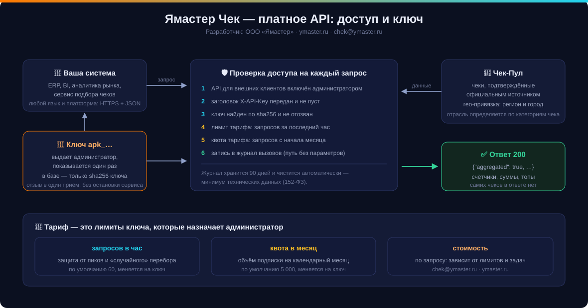
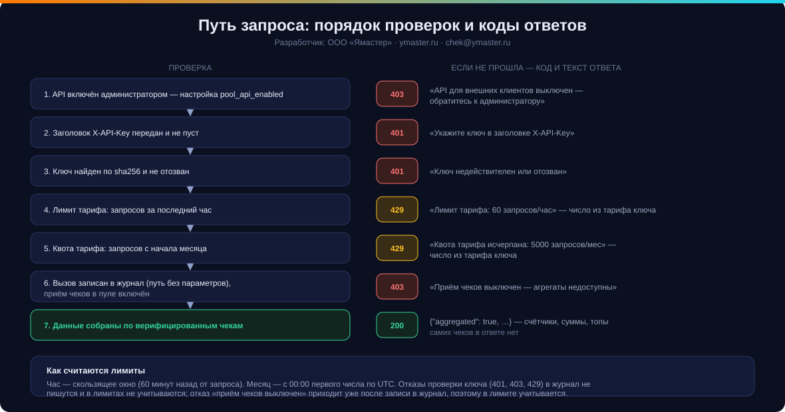
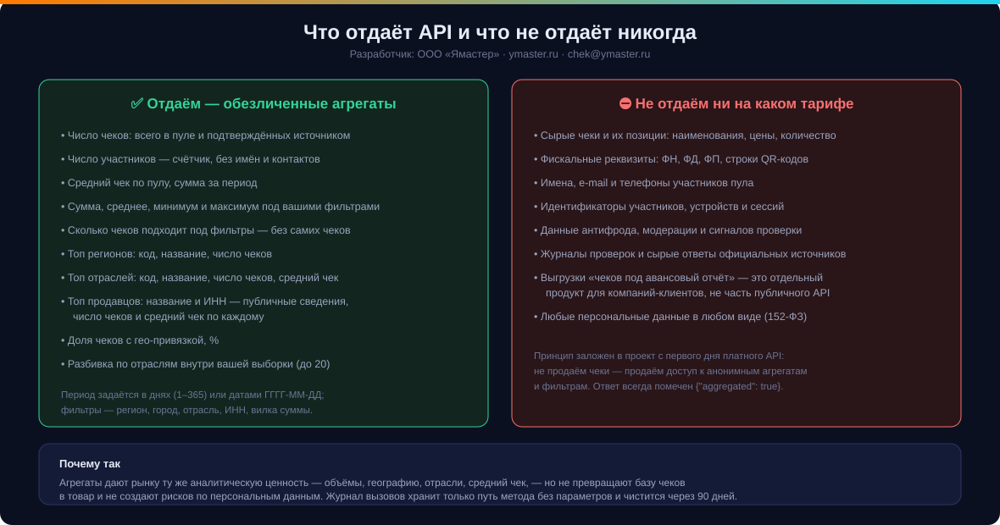

# API «Ямастер Чек» — платный доступ к агрегатам Чек-Пула

Разработчик и владелец сервиса: **ООО «Ямастер»** · <https://ymaster.ru> · <chek@ymaster.ru>

Документ для внешних разработчиков, которые подключаются к сервису за деньги или
по подписке. Здесь описано только то, что действительно работает в продукте:
каждый раздел сверен с кодом, примеры ответов — настоящие по составу полей.

---

## 1. Что это за продукт

«Ямастер Чек» принимает кассовые чеки от людей (камерой телефона, фотографией
QR-кода, в мини-приложении MAX, через веб-форму), проверяет их по официальным
источникам и складывает в общую базу — **Чек-Пул**. У каждого чека появляется
гео-привязка (регион, город) и отрасль.

Платное API даёт доступ к **обезличенным агрегатам** этой базы: объёмы,
география, отрасли, средний чек, топ продавцов, а также счётчики и суммы под
вашими фильтрами.

**Принцип, заложенный в продукт с первого дня платного API:** мы не продаём
чеки — мы продаём доступ к анонимным агрегатам и фильтрам. Наружу не уходят
сырые чеки, позиции, участники, их контакты и идентификаторы. Каждый ответ
помечен `"aggregated": true`.



---

## 2. Тарифы

Тариф — это **лимиты ключа**: сколько запросов разрешено за час и за
календарный месяц. Лимиты назначает администратор сервиса при выдаче ключа и
может изменить их под задачу клиента.

| Тариф | Запросов в час | Квота в месяц | Кому подходит |
|---|---|---|---|
| **Старт** | 60 | 5 000 | знакомство с данными, витрина, отчёт раз в день |
| **Бизнес** | 300 | 30 000 | регулярная аналитика, несколько отчётов в день, свои фильтры |
| **Аналитика** | 1 200 | 150 000 | продуктовая аналитика, перепродажа отчётов, частые срезы |

Числа «Старт» — значения по умолчанию в сервисе; «Бизнес» и «Аналитика» — те же
два параметра, увеличенные под задачу. Технически отличие тарифов состоит
только в этих двух числах: состав методов и полей одинаков на любом тарифе.

**Стоимость — по запросу.** Цена зависит от лимитов, срока подписки и задачи.
Напишите на <chek@ymaster.ru> — согласуем тариф, подпишем договор и выдадим ключ.

---

## 3. Как подключиться

Раздел «API для бизнеса» закрыт от посторонних: его видят только компании и ИП,
подтвердившие статус через корпоративную почту. Подключение идёт через кабинет
компании — отдельную страницу `/b2b/` (адрес сообщаем напрямую, с публичных
страниц сайта ссылки на него нет).

1. **Регистрация в кабинете.** Корпоративная почта на домене компании,
   наименование как в ЕГРЮЛ/ЕГРИП, ИНН, пароль не короче 8 символов и согласие
   на обработку персональных данных. Бесплатные домены (mail.ru, yandex.ru,
   gmail.com и подобные) не принимаются: такой ящик не доказывает, что заявку
   подал представитель организации.
2. **Подтверждение почты.** На корпоративный ящик приходит письмо со ссылкой —
   она действует 24 часа и только один раз.
3. **Проверка статуса.** Сервис проверяет ИНН (контрольная сумма; 10 цифр —
   ООО, 12 — ИП) и запрашивает карточку ЕГРЮЛ/ЕГРИП: организация существует,
   статус действующий, наименование совпадает с указанным. Дополнительно
   проверяются дубликаты и оценивается риск. Если карточка реестра недоступна,
   проверка помечается как выполненная по формальным признакам, а решение
   принимает администратор.
4. **Раздел открыт.** После подтверждения статуса в кабинете появляются страницы
   «Документация API», «Тарифы и состав» и «Обсудить подключение».
5. **Заявка.** В форме «Обсудить подключение» укажите тариф, задачу (что
   считаете, какие срезы нужны) и ожидаемый объём запросов.
6. **Решение.** По умолчанию работает частичная автоматизация: проверки
   выполняет сервис, а одобряет заявку и выдаёт ключ администратор. Решение
   приходит на корпоративную почту.
7. **Выдача ключа.** Ключ показывается в кабинете **один раз**. В базе хранится
   только sha256-хэш: восстановить показанный ключ невозможно, а утечка базы не
   раскрывает сами ключи. В письмах полный ключ не отправляется — только ссылка
   на кабинет, потому что письмо может быть переслано.
8. **Проверка включения.** API для внешних клиентов включается администратором
   отдельно. До включения любой запрос отвечает `403` с текстом
   «API для внешних клиентов выключен — обратитесь к администратору».
9. **Первый запрос.** Проверьте доступ методом `GET /v1/stats/overview` — он
   самый дешёвый и сразу показывает, что ключ работает.

**Стоимость.** Цены не публикуются: стоимость зависит от выбранных лимитов и
срока подписки. Укажите задачу в заявке или напишите на <chek@ymaster.ru> —
пришлём условия и счёт. Состав методов одинаков на любом тарифе.

**Если статус не подтвердился.** Проверьте, что почта на домене компании, ИНН
действующей организации, а наименование совпадает с реестром. Если данные верны
— напишите на <chek@ymaster.ru>, администратор проверит вручную.

Ключ выглядит так: `apk_` и 43 символа случайной строки (полная длина 47
символов), например `apk_P9_exHgl…`. В журнале и в панели ключ отображается
коротким префиксом — первые 12 символов и многоточие.

**Хранение ключа.** Ключ — это деньги клиента: держите его в переменных
окружения или в хранилище секретов, не кладите в код приложения, в репозиторий и
в адресную строку. Мы принимаем ключ только в заголовке запроса.

**Утечка ключа.** Сообщите нам — ключ отзывается сразу, без остановки остальной
интеграции: выдаётся новый, а отозванный начинает отвечать `401`.

---

## 4. Основы обращения

| Параметр | Значение |
|---|---|
| Базовый адрес | `https://<ваш-домен>/api/v1/pool-api` |
| Авторизация | заголовок `X-API-Key: apk_…` |
| Формат запроса и ответа | JSON, кодировка UTF-8 |
| Методы | `GET` — сводки и топы, `POST` — фильтры |
| Время | все периоды и границы месяца считаются по UTC |
| Версионирование | версия в пути: `/v1/…` |
| Интерактивная документация | `/api/docs` (Swagger UI), `/api/redoc`, спецификация `/api/openapi.json` |

Минимальный пример:

```bash
curl -sS "https://example.ymaster.ru/api/v1/pool-api/v1/stats/overview?days=30" \
  -H "X-API-Key: apk_ВАШКЛЮЧ"
```

Пример на Python:

```python
import requests

BASE = "https://example.ymaster.ru/api/v1/pool-api"
HEADERS = {"X-API-Key": os.environ["YMASTER_API_KEY"]}

r = requests.get(f"{BASE}/v1/stats/overview", params={"days": 30},
                 headers=HEADERS, timeout=30)
r.raise_for_status()
data = r.json()          # {"aggregated": True, "receipts_total": …}
```

Пример на JavaScript:

```js
const BASE = 'https://example.ymaster.ru/api/v1/pool-api';
const res = await fetch(`${BASE}/v1/stats/regions?days=30&limit=12`, {
  headers: { 'X-API-Key': process.env.YMASTER_API_KEY },
});
if (!res.ok) throw new Error(`${res.status}: ${(await res.json()).detail}`);
const { items } = await res.json();
```

---

## 5. Лимиты, квота и журнал вызовов

- **Часовой лимит** — скользящее окно: считаются обращения по ключу за 60 минут
  до текущего запроса. Превышение — `429`.
- **Месячная квота** — с 00:00 первого числа календарного месяца по UTC.
  Превышение — `429`; квота обнуляется сама с началом месяца.
- **Журнал вызовов.** Каждое успешное по ключу обращение пишется в журнал:
  только путь метода, без параметров запроса. Журнал чистится автоматически
  через 90 дней — минимум технических данных (152-ФЗ).
- Отказы проверки ключа (`401`, `403`, `429`) в журнал не пишутся и в лимитах не
  учитываются. Отказ «Приём чеков выключен — агрегаты недоступны» приходит уже
  после записи в журнал, поэтому в лимите учитывается.



**Как не упираться в лимиты.** Кэшируйте ответы у себя: агрегаты за период в 30
дней меняются медленно, разумный срок жизни кэша — от одного часа до суток.
При `429` повторяйте запрос с нарастающей задержкой (1 с, 2 с, 4 с…), а не
сразу. Если лимитов системно не хватает — это повод сменить тариф, а не
обходить его.

---

## 6. Методы

Общее у всех ответов: поле `"aggregated": true` и отсутствие персональных
данных. Суммы — в рублях, округление до двух знаков; доли — до одного знака.

### 6.1 `GET /v1/stats/overview` — сводка пула

Общая картина: сколько чеков, сколько подтверждено источником, сколько
участников, насколько база покрыта гео-данными, сколько чеков подтверждено за
период и каков средний чек.

| Параметр | Тип | По умолчанию | Диапазон |
|---|---|---|---|
| `days` | целое | `30` | окно выборки — от 1 до 365 дней |

```bash
curl -sS "$BASE/v1/stats/overview?days=30" -H "X-API-Key: $KEY"
```

```json
{
  "aggregated": true,
  "receipts_total": 18420,
  "receipts_verified": 16903,
  "participants": 2317,
  "geo_coverage_pct": 92.4,
  "verified_in_period": 1204,
  "period_days": 30,
  "avg_receipt_sum": 1246.35
}
```

| Поле | Смысл |
|---|---|
| `receipts_total` | всего чеков в пуле, любой статус |
| `receipts_verified` | чеков, подтверждённых официальным источником |
| `participants` | сколько разных участников сдали чеки (счётчик, без имён) |
| `geo_coverage_pct` | доля верифицированных чеков с определённым регионом, % |
| `verified_in_period` | верифицировано за последние `days` дней |
| `period_days` | запрошенное значение `days` — возвращается как есть |
| `avg_receipt_sum` | средний чек по всем верифицированным чекам, ₽ |

### 6.2 `GET /v1/stats/regions` — топ регионов

| Параметр | Тип | По умолчанию | Диапазон |
|---|---|---|---|
| `days` | целое | `30` | 1…365 |
| `limit` | целое | `12` | 1…95 |

```json
{
  "aggregated": true,
  "period_days": 30,
  "items": [
    { "region_code": "77", "region": "Москва", "receipts": 4210 },
    { "region_code": "78", "region": "Санкт-Петербург", "receipts": 1980 }
  ]
}
```

Учитываются только верифицированные чеки с непустым кодом региона; период — по
дате подтверждения (при её отсутствии — по дате создания).

**Как сервис трактует `days`** (одинаково во всех четырёх `GET`-методах). Окно
выборки зажимается в границы 1…365 дней: при `days=9999` в расчёт всё равно
пойдут чеки за последние 365 дней, при `days=0` — за один день. А поле
`period_days` в ответе возвращает **запрошенное** значение без зажима, поэтому
при `days=9999` вы увидите `"period_days": 9999` при фактическом окне в 365
дней. Передавайте `days` в диапазоне 1…365 — тогда расчёт и эхо совпадают;
сверку окна по `period_days` не стройте.

**Как сервис трактует `limit`.** Число элементов списка зажимается в свой
диапазон: до 95 для регионов, до 50 для отраслей и продавцов; значение меньше 1
приводится к 1. `region_code` из
ответа — то самое значение, которое принимает фильтр `region`.

### 6.3 `GET /v1/stats/industries` — топ отраслей

| Параметр | Тип | По умолчанию | Диапазон |
|---|---|---|---|
| `days` | целое | `30` | 1…365 |
| `limit` | целое | `18` | 1…50 |

```json
{
  "aggregated": true,
  "period_days": 30,
  "items": [
    { "industry": "food", "name": "Продукты", "receipts": 6120, "avg_sum": 942.18 },
    { "industry": "fuel", "name": "Топливо", "receipts": 1408, "avg_sum": 2310.0 }
  ]
}
```

Значение `industry` из ответа — значение для фильтра `industry`.

### 6.4 `GET /v1/stats/merchants` — топ продавцов

| Параметр | Тип | По умолчанию | Диапазон |
|---|---|---|---|
| `days` | целое | `30` | 1…365 |
| `limit` | целое | `10` | 1…50 |

```json
{
  "aggregated": true,
  "period_days": 30,
  "items": [
    { "merchant": "Пятёрочка", "inn": "7721546864", "receipts": 1240, "avg_sum": 812.44 }
  ]
}
```

Название продавца ограничено 120 символами. Название и ИНН — публичные сведения
из самого чека; чеков этого продавца, их номеров и сумм по отдельности метод не
отдаёт — только счётчик и среднее.

### 6.5 `POST /v1/filters/count` — сколько чеков под фильтрами

Отвечает числом, не выдавая чеки. Удобно для витрин вида «найдено N чеков» и
для оценки объёма выборки перед дорогим запросом.

```bash
curl -sS -X POST "$BASE/v1/filters/count" \
  -H "X-API-Key: $KEY" -H "Content-Type: application/json" \
  -d '{"date_from":"2026-09-01","date_to":"2026-09-30","region":"77","industry":"food","sum_min":300,"sum_max":5000}'
```

```json
{ "aggregated": true, "count": 3184 }
```

### 6.6 `POST /v1/filters/aggregate` — агрегаты под фильтрами

Те же фильтры, но вместо числа — сумма, среднее, минимум, максимум и разбивка
выборки по отраслям (до 20 отраслей).

```json
{
  "aggregated": true,
  "count": 3184,
  "sum": 3944126.4,
  "avg": 1238.42,
  "min": 300.0,
  "max": 5000.0,
  "by_industry": [
    { "industry": "food", "name": "Продукты", "receipts": 2210 },
    { "industry": "cafe", "name": "Кафе и рестораны", "receipts": 640 }
  ]
}
```

Пустая выборка — не ошибка: вернутся нули и пустой список отраслей.

```json
{ "aggregated": true, "count": 0, "sum": 0.0, "avg": 0.0, "min": 0.0, "max": 0.0, "by_industry": [] }
```

---

## 7. Фильтры (тело `POST`-методов)

Все поля необязательны; пустое тело означает «вся база верифицированных чеков».

| Поле | Тип | Как работает |
|---|---|---|
| `date_from` | строка `ГГГГ-ММ-ДД` | дата чека не раньше этой |
| `date_to` | строка `ГГГГ-ММ-ДД` | дата чека не позже этой; граница включительная |
| `region` | строка | код региона, точное совпадение (значения — из `/v1/stats/regions`) |
| `city` | строка | вхождение в название города без учёта регистра |
| `industry` | строка | код отрасли, точное совпадение (значения — из `/v1/stats/industries`) |
| `inn` | строка | ИНН продавца, точное совпадение |
| `sum_min` | число | сумма чека не меньше, ₽ |
| `sum_max` | число | сумма чека не больше, ₽ |

Особенности, которые стоит знать до интеграции:

- В расчёте участвуют только чеки со статусом «подтверждён источником».
- Даты проверяются мягко: значение `date_from` или `date_to` с ошибкой формата
  **игнорируется** — фильтр просто не применяется, запрос отвечает `200`.
  `"не дата"` и `"2026-13-45"` одинаково приводят к выборке без ограничения по
  дате. Проверяйте формат на своей стороне, иначе выборка окажется шире
  ожидаемой, а вы этого не увидите.
- Числа и строки проверяются строго: `sum_min`, `sum_max`, `region`, `city`,
  `industry` и `inn` должны приходить значением своего типа. Строка `"не число"`
  вместо `sum_min` или число `77` вместо строки `region` дают `422` ещё до
  обращения к данным (см. раздел 8).
- Противоречивая вилка суммы — не ошибка: при `sum_min` больше `sum_max`
  вернутся `200` и пустая выборка (нули).
- Фильтр по городу применяется после выборки как поиск вхождения, поэтому
  `city=москва` найдёт и «Москва», и «Московский».
- Фильтры складываются (логическое «и»).
- Методы фильтров читают выборку целиком, поэтому на очень широких срезах без
  дат отвечают дольше остальных. Сужайте период — это и быстрее, и точнее.

---

## 8. Ошибки

Ответ об ошибке — JSON вида `{"detail": "текст"}`. Тексты постоянные, их можно
показывать пользователю и писать в журнал.

| Код | `detail` | Что делать |
|---|---|---|
| `401` | `Укажите ключ в заголовке X-API-Key` | добавить заголовок |
| `401` | `Ключ недействителен или отозван` | проверить ключ; если он отозван — запросить новый |
| `403` | `API для внешних клиентов выключен — обратитесь к администратору` | доступ не включён: написать нам |
| `403` | `Приём чеков выключен — агрегаты недоступны` | пул на паузе: повторить позже |
| `422` | `<поле>: <сообщение проверки>` | тело `POST` не соответствует схеме фильтров |
| `429` | `Лимит тарифа: <N> запросов/час` | снизить частоту, повторить с задержкой |
| `429` | `Квота тарифа исчерпана: <N> запросов/мес` | дождаться начала месяца или сменить тариф |
| `5xx` | — | сообщить нам: это наша ошибка, не ваша |

**Форма `detail`.** Для отказов доступа, лимитов и состояния пула `detail` —
строка с постоянным текстом из таблицы выше. Для ошибки проверки тела `POST`
`detail` — тоже строка, но собранная из замечаний схемы: `<имя поля>:
<сообщение>`, не больше пяти замечаний. Настоящие примеры:

```json
{ "detail": "sum_min: Input should be a valid number, unable to parse string as a number" }
```
```json
{ "detail": "region: Input should be a valid string" }
```

Сообщения проверки приходят на английском — это текст схемы запроса, а не наш
текст для пользователя: показывать его человеку не нужно, достаточно понять,
какое поле передано неверно. Постоянные русские тексты — только у отказов
доступа и лимитов, их можно показывать.

Отдельно: `200` при пустой выборке — нормальный ответ, а не ошибка (см. 6.6).

---

## 9. Граница данных



**Отдаём:** счётчики чеков и участников, суммы и средние, доли, топы регионов,
отраслей и продавцов (название и ИНН — публичные сведения), разбивку выборки по
отраслям.

**Не отдаём ни на каком тарифе:** сырые чеки и позиции, фискальные реквизиты
(ФН, ФД, ФП) и строки QR-кодов, имена и контакты участников, идентификаторы
участников и устройств, данные антифрода и модерации, сырые ответы официальных
источников, любые персональные данные.

Подбор конкретных чеков под авансовый отчёт — отдельный продукт для
компаний-клиентов сервиса (кабинет бухгалтера), а не часть публичного API.

**152-ФЗ.** Агрегаты не являются персональными данными: в ответах нет ни
субъектов, ни признаков, позволяющих их установить. Журнал вызовов хранит путь
метода без параметров и удаляется через 90 дней.

---

## 10. Раздел для администратора сервиса

Этот раздел — для нас, а не для клиента: как устроены выдача и контроль ключей.

**Включение API.** Отдельная настройка приложения `pool_api_enabled`
(`"1"` — включено). По умолчанию выключено: без явного включения все методы
отвечают `403`.

**Панель.** Раздел администрирования Чек-Пула, блок «Партнёр / Запросов час /
Квота мес» с кнопкой «Выдать ключ». Выданный ключ показывается один раз —
дальше в списке виден только префикс.

**Маршруты администратора** (доступны только с правами администратора,
префикс `/api/v1/pool-admin`):

| Метод | Что делает |
|---|---|
| `GET /api-keys` | список ключей (до 200): название, префикс, признак активности, лимиты, израсходовано за месяц, последнее обращение, дата выдачи |
| `POST /api-keys` | выдать ключ: `{name, rate_per_hour, monthly_quota}` → в ответе полный ключ **один раз** |
| `POST /api-keys/{id}/revoke` | отозвать ключ (становится неактивным, отвечает `401`) |

Ошибки админ-методов: `422` «Укажите название партнёра» — пустое название;
`422` «Лимиты — целые числа» — нечисловые лимиты; `404` «Ключ не найден» —
отзыв несуществующего ключа. Лимиты приводятся к минимуму 1.

**Аудит.** Выдача и отзыв ключа пишутся в журнал действий администратора
(`pool_api_key_created`, `pool_api_key_revoked`) с названием партнёра,
префиксом ключа и лимитами. Полный ключ в аудит не попадает.

**Обслуживание.** Чистка журнала вызовов старше 90 дней — служебная процедура
`purge_calls`; статистика по ключам видна в сводке админ-раздела
(`api_keys_total`, `api_keys_active`).

**Что проверить при обращении клиента:** включён ли API, активен ли ключ, не
исчерпаны ли лимиты, включён ли приём чеков в пуле — это ровно те четыре
причины отказов, которые видит клиент.

**Модерация контура B2B (v1.70.45).** Заявки компаний и подтверждение их статуса
ведутся в разделе администратора `#/b2badmin` («API для бизнеса: модерация»).
Каждая поверхность раздела помечена «Это не видит никто», и та же пометка
приходит в каждом ответе API полем `marker`.

Режимы автоматизации (настройка `b2b_auto_mode`):

| Режим | Что делает сервис | Что делает администратор |
|---|---|---|
| `full` | проверки → статус подтверждён → заявка одобрена → ключ выдан | смотрит журнал, может отозвать |
| `partial` (по умолчанию) | проверки → статус подтверждён; заявка в очереди | одобряет заявку и выдаёт ключ в один клик |
| `off` | ничего: проверки не запускаются сами | всё вручную, включая кнопку «Перепроверить» |

Переключатели: `b2b_enabled` (контур по умолчанию закрыт), `b2b_auto_issue_key`,
`b2b_require_registry`, `b2b_allow_free_domains`, `b2b_notify_admin`,
`b2b_notify_email`.

**Маршруты модерации** (префикс `/api/v1/b2b-admin`, только администратор):

| Метод | Что делает |
|---|---|
| `GET /overview` | сводка по статусам, очередь заявок, текущий режим |
| `PUT /config` | режим автоматизации и переключатели |
| `GET /companies` | список компаний с фильтром по статусу и поиском |
| `GET /companies/{id}` | карточка: данные, все проверки, заявки, события, ключ |
| `POST /companies/{id}/verify` | подтвердить статус вручную |
| `POST /companies/{id}/reject` | отклонить с причиной (уходит в письме) |
| `POST /companies/{id}/block`, `/unblock` | закрыть и восстановить доступ |
| `POST /companies/{id}/recheck` | запустить проверки заново |
| `POST /companies/{id}/resend` | выслать письмо подтверждения повторно |
| `GET /applications` | очередь заявок с результатами проверок |
| `POST /applications/{id}/approve` | одобрить и выдать ключ по лимитам тарифа |
| `POST /applications/{id}/reject` | отклонить заявку с причиной |
| `POST /applications/{id}/revoke` | отозвать выданный ключ |
| `GET /events`, `GET /blocked` | журнал контура и закрытые кабинеты |

Действия администратора пишутся в общий журнал аудита: `b2b_company_verified`,
`b2b_company_rejected`, `b2b_application_approved`, `b2b_application_rejected`,
`b2b_key_revoked`, `b2b_config_changed`, `b2b_letter_resent`. История по каждой
компании дополнительно видна в журнале контура (`b2b_events`).

Таблицы контура: `b2b_companies`, `b2b_applications`, `b2b_checks`,
`b2b_tokens`, `b2b_events`. Механизм описан в `docs/b2b_access.md`.

---

## 11. Что обсуждается дальше

Ниже — планы, а не обязательства и **не** часть текущего API. Публикуем, чтобы
клиент понимал направление развития и мог повлиять на приоритет.

- **Песочница с демо-данными** для интеграции до боевого подключения.
- **Уведомления (вебхуки)** о существенном изменении агрегатов вместо опроса.
- **Выгрузка среза** в табличном виде: то, что сейчас собирается из нескольких
  методов фильтров.
- **Отчёт о расходе квоты** в ответе, чтобы клиент видел остаток без подсчёта на
  своей стороне.
- **Личный кабинет партнёра**: свои ключи, расход, документы и счета.

Уже доступно сегодня и не требует доработки: спецификация OpenAPI
(`/api/openapi.json`), интерактивная документация (`/api/docs`, `/api/redoc`),
отзыв ключа без остановки сервиса, журнал вызовов с ограниченным сроком
хранения.

---

## 12. Поддержка

- Письмо: <chek@ymaster.ru> — подключение, тарифы, договор, счета.
- Кабинет компании: страница `/b2b/` — регистрация, подтверждение статуса, заявка, ключ и расход лимитов.
- Сайт: <https://ymaster.ru>.
- В письме укажите префикс ключа (первые 12 символов), код ответа и время
  запроса по UTC: этого достаточно, чтобы найти обращение в журнале.
- Полный ключ в письмах присылать не нужно — мы его и не увидим в базе.

---

Состав методов, тексты ответов и лимиты в этом документе сверены с реализацией
сервиса. Изменения API сопровождаются записью в `CHANGELOG.md` и, при изменении
состава полей, новой версией в пути метода.
