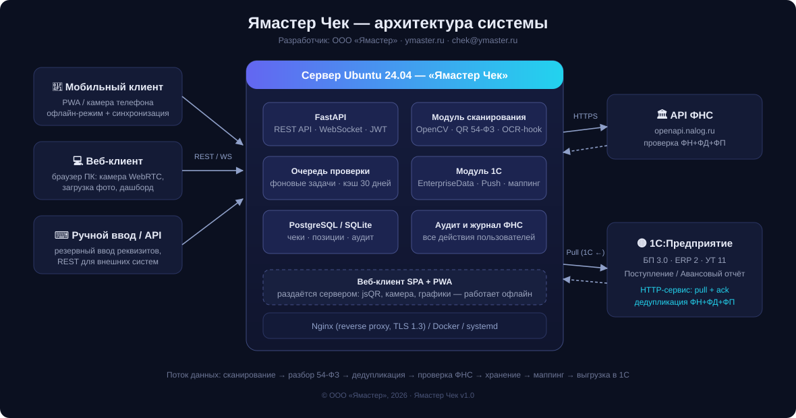
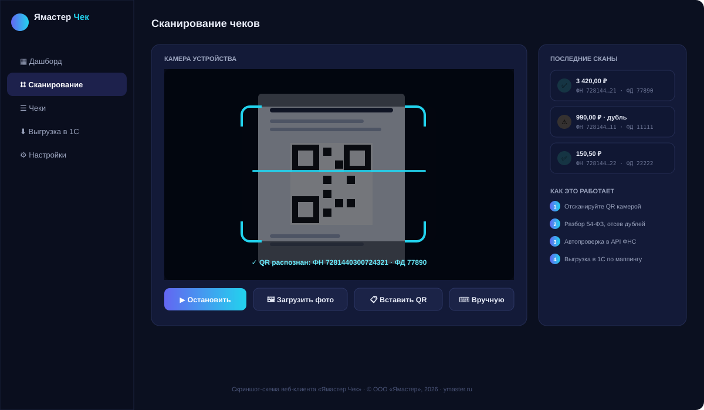
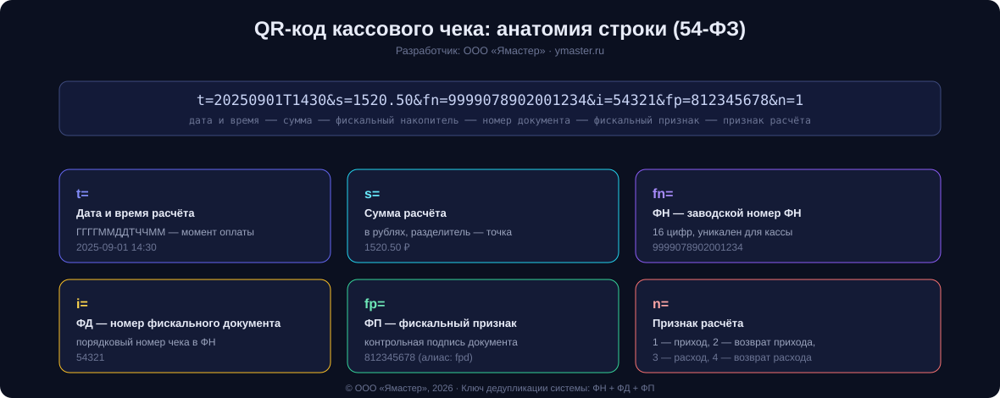
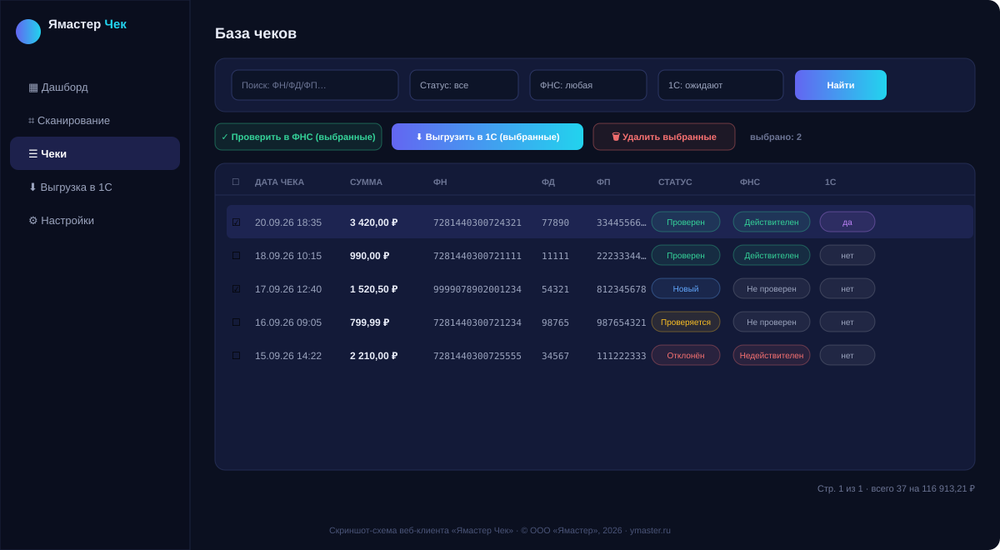
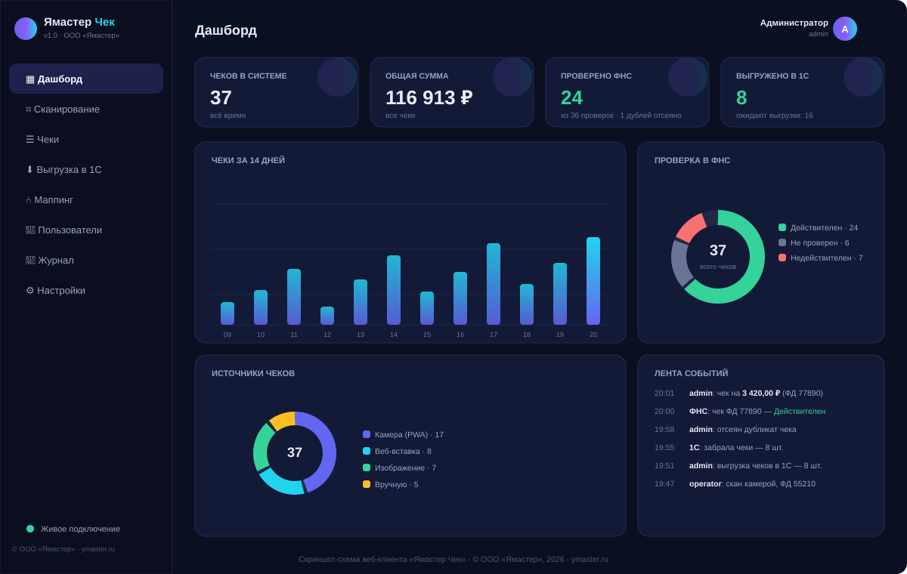

# 📖 Руководство пользователя «Ямастер Чек»

> **Разработчик и владелец идеи: ООО «Ямастер»**
> Сайт: [ymaster.ru](https://ymaster.ru) · E-mail: [chek@ymaster.ru](mailto:chek@ymaster.ru)
> Версия документа: 1.0 (22.09.2026)

---

## Содержание

1. [Что это за система](#1-что-это-за-система)
2. [Вход в систему](#2-вход-в-систему)
3. [Установка на телефон (PWA)](#3-установка-на-телефон-pwa)
4. [Сканирование чеков](#4-сканирование-чеков)
5. [Работа с базой чеков](#5-работа-с-базой-чеков)
6. [Проверка чеков в ФНС](#6-проверка-чеков-в-фнс)
7. [Выгрузка в 1С](#7-выгрузка-в-1с)
8. [Маппинг реквизитов](#8-маппинг-реквизитов)
9. [Дашборд и аналитика](#9-дашборд-и-аналитика)
10. [Настройки и администрирование](#10-настройки-и-администрирование)
11. [Частые вопросы и решение проблем](#11-частые-вопросы-и-решение-проблем)

---

## 1. Что это за система

**Ямастер Чек** — рабочее место для сбора кассовых чеков и передачи их в 1С.
Вместо ручного ввода реквизитов сотрудник сканирует QR-код с чека — система сама
извлекает дату, сумму, ФН, ФД, ФП, проверяет чек в ФНС и передаёт в 1С.



**Сквозной процесс:** сканирование → разбор 54-ФЗ → отсев дубликатов → проверка ФНС →
хранение → маппинг → выгрузка в 1С.

Роли в системе (регистрация — только по приглашению администратора, роль выдаётся ссылкой):

| Роль | Права |
|---|---|
| **Пользователь** | Сканирует чеки (камера/фото/вручную), видит **только свои** чеки. Проверку и выгрузку делает бухгалтер |
| **Бухгалтер** | Всё, что пользователь + все чеки, проверка в ФНС, назначение сотрудника, выгрузка в 1С и CSV, маппинг (просмотр) |
| **Администратор** | Абсолютно все права: пользователи и приглашения, настройки ФНС/1С, маппинг, удаление любых чеков, журнал. **Администратор всегда один** — права передаются специальной кнопкой |

---

## 2. Вход в систему

1. Откройте адрес сервера в браузере, например `http://адрес-сервера:8000`.
2. Введите логин и пароль (выдаёт администратор; при первой установке — `admin` / `admin123`).
3. Нажмите **«Войти в систему»**.

**Первый вход администратора:** пароль `admin123` — временный. Система **сама потребует**
задать собственный пароль (окно «Смените пароль», без него дальше не пустить).

**Регистрация сотрудников** возможна **только по ссылке-приглашению** от администратора
(раздел «Пользователи → + Создать приглашение»). Роль (бухгалтер/пользователь) вшита
в приглашение — путаницы не бывает. Перебор паролей блокируется автоматически
(5 неудачных попыток → пауза 15 минут).

> Сессия живёт 12 часов, затем потребуется повторный вход.

---

## 3. Установка на телефон (PWA)

Веб-клиент — это PWA: его можно поставить на телефон как обычное приложение.

**Android (Chrome):** откройте адрес сервера → меню ⋮ → **«Установить приложение»**.
**iPhone (Safari):** кнопка «Поделиться» → **«На экран “Домой”»**.

После установки на телефоне появится иконка «Ямастер Чек», приложение откроется
в полный экран и сможет использовать камеру для сканирования.

**Офлайн-режим:** если связь с сервером пропала, сканы не теряются — они сохраняются
на устройстве (счётчик виден рядом с пунктом меню «Сканирование») и автоматически
отправятся при появлении сети.

---

## 4. Сканирование чеков



Раздел **«Сканирование»** — четыре способа добавить чек:

### 4.1. Камера (основной способ)
1. Нажмите **«▶ Включить камеру»** и разрешите доступ.
2. Наведите камеру так, чтобы QR-код чека попал в рамку.
3. Код распознается автоматически — прозвучит короткий сигнал, чек появится в списке справа.

Можно сканировать чеки подряд: камера остаётся включённой, повторное распознавание
того же чека игнорируется 2,5 секунды, чтобы не было случайных дублей.

### 4.2. Фото чека (загрузка изображения)
Нажмите **«🖼 Загрузить фото»** или перетащите фотографии в пунктирную зону — можно
несколько сразу. Изображение обрабатывается в два этапа: сначала на устройстве (быстро),
затем, если QR не найден, — на сервере устойчивым алгоритмом OpenCV (повороты, шум, блики).

> Если на одной фотографии окажутся **разные** чеки, система покажет список найденных
> и предложит выбрать, какие добавить.

### 4.3. Вставка QR-текста
Если строка QR уже есть в буфере обмена (например, из другого приложения), нажмите
**«📋 Вставить QR-текст»** и вставьте её. Пример строки:

```
t=20250901T1430&s=1520.50&fn=9999078902001234&i=54321&fp=812345678&n=1
```



### 4.4. Ручной ввод (резервный)
Если QR повреждён, нажмите **«⌨ Ввести вручную»** и заполните реквизиты с бумажного чека:
дата и время, сумма, ФН, ФД, ФП, признак расчёта (приход/возврат).

> Все способы защищены дедупликацией: повторный чек по ключу **ФН+ФД+ФП** в базу
> повторно не попадает — вы увидите предупреждение «Дубликат отсеян».

---

## 5. Работа с базой чеков



Раздел **«Чеки»** — таблица всех чеков с фильтрами:

- **Поиск** — по номерам ФН/ФД/ФП и строке QR;
- **Статус** — новый / проверяется / проверен / отклонён ФНС;
- **Проверка ФНС** — действителен / недействителен / не найден / не проверен;
- **Выгрузка в 1С** — ожидают выгрузки / выгружены;
- **Даты** — период по дате чека.

**Массовые действия:** отметьте чеки галочками — станут активны кнопки:

| Кнопка | Действие |
|---|---|
| ✓ Проверить в ФНС | отправить выбранные чеки на проверку |
| ✓✓ Проверить все новые | отправить на проверку все необработанные |
| ⬇ Выгрузить в 1С | сформировать пакет выгрузки по выбранным |
| 🗑 Удалить | удалить выбранные чеки (выгруженные — только админ) |

Клик по строке открывает **карточку чека**: полная строка QR (копируется нажатием),
реквизиты, ответ ФНС, позиции чека (если пришли от ФНС/ОФД), история выгрузки.

### 5.1. Сотрудник (подотчётник) — главная кнопка для бухгалтера

Чтобы не вносить чеки руками в авансовые отчёты:

1. Отметьте галочками чеки сотрудника;
2. Нажмите **«👤 Назначить сотрудника»** и выберите ФИО (система подсказывает ранее введённые);
3. Выгрузите в 1С — ФИО попадёт в поле «Контрагент» документа, авансовый отчёт заполнится сам.

Сотрудника можно указать и в карточке чека (клик по строке → «Для бухгалтерии»).
Также доступна **«📊 CSV-сводка»** — Excel-файл по выбранным чекам для быстрой проверки.

---

## 5.2 Данные чека из сервисов (v1.2.0) — бухгалтер

Кнопка **📥** у чека (или «📥 Данные сервисов» для выбранных) запрашивает
полную информацию: магазин, ИНН, адрес, кассир и **все позиции**. Источники
опрашиваются по очереди с паузами 2–7 секунд — блокировок не бывает.
Статус источников: Настройки → «Источники данных чека».

## 5.3 Редактирование чека (v1.2.0) — бухгалтер/админ

Кнопка **✏️** открывает редактор: дата, сумма, тип (приход/возврат), ФН/ФД/ФП,
магазин, ИНН, адрес, кассир, сотрудник, комментарий и **таблица позиций**
(добавление/удаление строк). Реквизиты уже выгруженных в 1С чеков меняет
только администратор — защита целостности данных.

## 5.4 «От кого прислал» и уведомления (v1.2.0)

Чек, отсканированный сотрудником, **сразу** помечается его именем — бухгалтеру
не нужно ничего назначать вручную (переназначить могут бухгалтер/админ).
Сотрудник у своего чека нажимает **🔔** и сообщает бухгалтерии о замене,
возврате и т.п. — уведомление видно в таблице (колокольчик) и в CSV.

### 5.5. Подбор из Чек-Пула и участники компании

Раздел **«Подбор из пула»** доступен бухгалтеру и администратору. Во вкладке
**«Мои чеки компании»** показаны чеки, уже закреплённые за компанией. Фильтр
**«Участник»** группирует их по обезличенному коду: имя, почта и исходный ID
участника не раскрываются, а в разных компаниях коды одного участника различаются.
Отсутствующая или повреждённая связь показывается как **«Без участника»**.

Счётчики участников учитывают период из вкладки поиска, но не выбранный код.
Фильтр применяется до разбиения на страницы; кнопка **«CSV (АО-1, Excel)»**
выгружает тот же срез и добавляет колонку обезличенного кода. Смена участника
или компании снимает выбор чеков. Группировка не меняет баллы, согласия и
историю пула. После смены серверного `SECRET_KEY` коды участников изменятся.

### 5.6. Supabase демо

Раздел **«Supabase демо»** доступен администратору и бухгалтеру, если включён
`SUPABASE_DEMO_ENABLED`. Он показывает синтетические чеки из отдельного контура
Supabase: компании, участники, статусы, суммы и позиции. Фильтры работают по
снимку, кнопка «Обновить» перечитывает данные.

Контур только для чтения и не заменяет рабочую базу приложения: переносы, баллы,
согласия и реестр не меняются. Браузер использует publishable key; базовые таблицы
Supabase закрыты RLS, свободная регистрация Supabase Auth отключена.

## 6. Проверка чеков в ФНС

Статусы проверки:

| Статус | Значение |
|---|---|
| 🟦 Новый | чек добавлен, проверка не запускалась |
| 🟨 Проверяется | запрос в ФНС выполняется |
| 🟩 Действителен | чек найден в ФНС, фискальный признак совпал |
| 🟨 Не найден | ФНС пока не знает чек (ОФД мог не передать — проверьте позже) |
| 🟥 Недействителен | контроль не пройден — чек вызывает сомнения |

Результаты приходят в интерфейс мгновенно (WebSocket) — уведомление появится
в правом нижнем углу, статусы обновятся сами.

**Демо-провайдер:** если администратор ещё не подключил реальное API ФНС, проверки
выполняет встроенный имитатор — statuses меняются так же, но в реальную ФНС запросы не ходят.
Как подключить реальную ФНС — см. раздел 10 и [docs/knowledge/fns_auth.md](knowledge/fns_auth.md).

**Кэш:** повторная проверка чека в течение 30 дней не отправляет запрос в ФНС —
используется сохранённый результат (экономия лимитов API).

---

## 7. Выгрузка в 1С

Раздел **«Выгрузка в 1С»** — два способа передачи чеков:

### 7.1. Файловый экспорт (просто и быстро)
1. Выберите документ 1С (**Поступление товаров и услуг** / **Авансовый отчёт** / **ПКО**).
2. Выберите формат **EnterpriseData JSON** или **XML**.
3. Нажмите **«⬇ Выгрузить ожидающие»** — скачается файл, чеки пометятся как выгруженные.
4. Загрузите файл в 1С (обработка загрузки EnterpriseData / вручную по вашей процедуре).

Повторная выгрузка тех же чеков в 1С **не создаст дублей** — 1С отсекает их по ключу ФН+ФД+ФП.

### 7.2. Push-режим (1С забирает сама — рекомендуется)
1. Администратор: **Настройки → Интеграция с 1С** → кнопка «показать» — скопируйте токен.
2. В 1С настройте регламентное задание по готовому модулю
   [integration_1c/РегламентноеЗадание_ЗагрузкаЧековЯмастер.bsl](../integration_1c/РегламентноеЗадание_ЗагрузкаЧековЯмастер.bsl)
   (пошагово — [docs/INTEGRATION_1C.md](INTEGRATION_1C.md)).
3. 1С периодически забирает новые проверенные чеки и подтверждает загрузку.

Проверить связь можно в браузере: `http://сервер/onec/v1/ping` с заголовком `X-API-Token`.

### 7.3. Первичка: электронные УПД (с v1.70.94) — бухгалтер/админ
1. Откройте **«Первичка (УПД)»** в меню.
2. Перетащите XML-файлы УПД или счетов-фактур (форматы ФНС 5.01–5.03) либо ZIP-архив, выгруженный из Диадока, СБИС или Такскома, — до 50 документов за раз.
3. Администратор выбирает компанию или оставляет **«Определить по ИНН покупателя»**.
4. У каждого документа — итог проверки: **«Без замечаний»**, **«Есть замечания»** или **«Ошибки»**; подробности — в карточке (**«Открыть»**).

Проверяются номер и дата, ИНН (контрольная сумма) и КПП продавца и покупателя, арифметика строк и итогов, ставка НДС (с 2026 года — 22 %) и формат 5.03 (с 01.04.2026 в ЭДО — только он). Тот же документ второй раз не загрузится, а исправленный (строка 1а) загрузится отдельной строкой. Титул покупателя и корректировочные документы пока не принимаются.

С v1.70.95 XML формата 5.03 дополнительно сверяется с официальной схемой ФНС. В карточке видно
«Файл соответствует схеме ФНС 5.03» или замечание с подробностями: какого элемента не хватает или
какое значение недопустимо.

#### PDF, сканы и фото печатной формы (с v1.70.95)
1. Перетащите в то же поле PDF, скан или фото УПД или счёта-фактуры (JPG, PNG, TIFF).
2. Программа распознает реквизиты на своём сервере — без облаков и без оплаты. PDF из 1С и систем ЭДО
   читается по тексту за доли секунды; скан или фото — 2–6 секунд.
3. Откроется окно сверки: слева изображение (кнопка **«Крупнее»**), справа поля. Поле с **⚠** распознано
   неуверенно, пунктирное — не найдено. Если в прошлых документах продавец уже был, появится подсказка
   с кнопкой **«Подставить»**.
4. Исправьте, что нужно, и нажмите **«Сохранить в реестр»** — или **«Пропустить»**. Без «Сохранить»
   документ в реестр не попадает.

Бумажный документ можно ввести и без файла: кнопка **«✍️ Ввести вручную»**. В реестре у таких документов
видно, откуда они: PDF, скан или фото, введён вручную. Это не электронные документы ЭДО — оригинал
остаётся на бумаге или в PDF.

**Для администратора.** Сканам и фото нужны языковые модели Tesseract (8 МБ). Если под полем загрузки
написано «Распознавание сканов и фото: не настроено», нажмите **«Скачать модели (8 МБ)»** — сервер
скачает их с GitHub и проверит хеши. Там же видно время и память последнего распознавания.

#### Выгрузка в 1С (с v1.70.96)
1. В реестре «Первички» нажмите **«⬇ В 1С»**. Без отметок выгружаются новые документы — ещё не выгруженные,
   с учётом фильтра дат. Чтобы выгрузить определённые, отметьте их флажками (в том числе уже выгруженные).
2. Выберите формат. **«Файлы УПД для 1С»** — для типовой 1С:Бухгалтерии 3.0: в 1С откройте **«Покупки →
   Поступление (акты, накладные, УПД)»**, нажмите **«Загрузить → Из файла»** и выберите файл. 1С создаст
   документ поступления и предложит сопоставить номенклатуру — как с файлом из ЭДО Лайт. Несколько
   документов приходят архивом ZIP: распакуйте его и загрузите файлы. **EnterpriseData** (JSON или XML) —
   для обработки или расширения 1С.
3. Окно сразу покажет, сколько документов уйдёт, сколько с ошибками проверки останется (их можно включить
   флажком **«и документы с ошибками»**) и какие документы нельзя выгрузить файлом и почему — например, нет
   номера или даты, у продавца нет ИНН. Такие документы поправьте или внесите в 1С вручную.
4. Нажмите **«Скачать»**. Выгруженные документы получают отметку «✓» в колонке «1С»; фильтр «1С: не
   выгружены» показывает остальные. Один документ можно выгрузить и из карточки — **«⬇ Файл для 1С»**.

Файл УПД собирается из реквизитов реестра — поэтому выгружаются и документы из PDF, сканов и ручного ввода —
и до выдачи проверяется по официальной схеме ФНС. Подписанта и адресов в реестре нет: в файле подписант
помечен «не указан». Юридической силы такой файл не имеет — это файл для загрузки в свою 1С, а не документ
для контрагента. Если документ уже загружен в 1С, второй раз его не загружайте.

**Для обмена без участия человека** (обработка или расширение 1С): `/onec/v1/primary/pull` и `/ack`,
`/onec/v1/primary/enterprise-data`, файл УПД документа `/onec/v1/primary/{id}/upd` — с токеном компании, как у
чеков (см. [INTEGRATION_1C.md](INTEGRATION_1C.md)).

### 7.4. Что нужно от клиента (с v1.70.97) — бухгалтер/админ

Раздел **«Что нужно от клиента»** — список того, чего не хватает для закрытия месяца, срок сдачи и
напоминания клиенту. Бухгалтер работает со своей компанией, администратор выбирает компанию.

1. Выберите месяц (по умолчанию — прошлый) и нажмите **«🔎 Найти недостающее»**. Программа найдёт:
   - поставщиков, которые присылали документы два из трёх прошлых месяцев, а в этом месяце — нет
     (с обычной суммой);
   - чеки, которые ФНС не подтвердила (не найден или недействителен), — с ответственным: кто сканировал;
   - УПД и счета-фактуры с ошибками проверки — нужен исправленный документ.
   Повторный поиск дублей не создаёт, отменённое вами не возвращает.
2. Свой запрос — **«＋ Добавить запрос»** (что нужно, от кого, сумма). Пришедший документ закрывает запрос
   сам: УПД от ожидаемого поставщика, подтверждённый чек, исправление документа. Вручную —
   **«✓ Получено»**, **«Отменить»** (с причиной) или **«↺ Снова ждём»**.
3. **«⚙ Срок и напоминания»**: срок — число следующего месяца (по умолчанию 5-е) и «час икс» (по умолчанию
   18:00 МСК); напоминать за 3, 1 и 0 дней до срока и повторять после срока (по умолчанию раз в 2 дня,
   3 раза, не дольше 30 дней); каналы — Telegram, MAX (если боты включены администратором) и почта клиента;
   кому — руководителю компании и/или сотрудникам. Чек без подтверждения ФНС всегда напоминается лично
   тому, кто его сканировал. Плановые напоминания приходят в 10:00 по Москве.
4. **Автонапоминания включает бухгалтер** — флажок «Напоминать клиенту автоматически». Без него программа
   клиенту не пишет; список и журнал работают и так. **«📣 Напомнить сейчас»** сначала показывает, кому и
   что уйдёт, и предупреждает, если общие запросы некому отправить (у руководителя нет привязанного бота, а
   почта клиента не задана).
5. **Журнал** внизу — письменный след на случай «я всё отправил»: кто, когда, каким каналом и с каким текстом
   получил напоминание, когда документ пришёл или запрос отменён. Записи не удаляются.

В шапке — срок сдачи за выбранный месяц, расписание напоминаний (✓ — отправлено) и дисциплина клиента:
какая доля документов за три месяца пришла в срок.

**Эскалация (с v1.70.99).** Если сотрудник не прислал чек или документ по своей покупке за 3 дня, запрос видит и
руководитель: в его напоминании пункт отмечен «⚠» с именем сотрудника и числом дней; копия — на почту клиента.
В журнале — запись «Передано руководителю» (один раз). Срок — поле «показать руководителю через, дней» в
«Срок и напоминания»; 0 — не передавать.

### 7.5. Банк: выписка (с v1.70.98) — бухгалтер/админ

Раздел **«Банк: выписка»** находит платежи без документов и чеки, которые сотрудник оплатил сам.
Бухгалтер работает со своей компанией, администратор выбирает компанию.

1. В интернет-банке выгрузите выписку **«в 1С»** (файл `kl_to_1c.txt`, формат «1CClientBankExchange») и нажмите
   **«⬆ Загрузить выписку»**. Программа покажет итог: сколько операций, каким нужны документы, для скольких
   документ уже найден, сколько без документов; налоги, зарплата, комиссии банка, кредиты, выдачи под отчёт,
   поступления и переводы между своими счетами документов не требуют и только считаются.
2. Документ ищется сам: для покупки по карте — чек на ту же сумму (за 3 дня до списания или днём позже), для
   оплаты поставщику — УПД или счёт-фактура этого ИНН на ту же сумму либо документ с номером из назначения
   платежа. Нашёлся — вкладка **«Документ найден»**, с пометкой, что именно найдено.
3. Вкладка **«Без документов»**: такие платежи сами попадают в **«Что нужно от клиента»** (вид «🏦 платёж без
   документов») и напоминаются вместе с остальным. Покупка по карте сотрудника напоминается ему лично — укажите
   карты в **«⚙ Карты и срок хранения»** (последние 4 цифры и сотрудник). Пришёл чек или УПД — запрос закрывается
   сам; кнопка **«🔄 Сопоставить заново»** проверяет всё сразу. **«Документы не нужны»** (с причиной, например
   «возврат займа») снимает платёж и отменяет запрос с записью в журнал.
4. Вкладка **«К возмещению»**: чеки за период выписки, которых в ней нет, — сотрудник платил своими. Сумма к
   возмещению — «к учёту» (без личных покупок). Отметьте **«✓ Возмещено»** или **«Не возмещать»** (с причиной,
   например «оплачено из подотчётных»); **«⬇ Таблица для авансового отчёта (CSV)»** открывается в Excel. Последние
   3 дня выписки ждут следующую выписку: списание по карте приходит позже покупки.
5. Выписка другой организации не принимается (ИНН не совпадает с ИНН компании), повторная загрузка того же
   файла — тоже; пересекающиеся выписки операции не задваивают. Вкладка **«Выписки»** — что загружено; выписку
   можно удалить (открытые запросы по ней отменятся с пометкой).

Хранится минимум: только списания, которым нужны документы, без полных номеров счетов; файл выписки не
сохраняется. Срок хранения операций — в «⚙ Карты и срок хранения» (по умолчанию 3 года).

### 7.6. Банк по API: выписка сама (с v1.70.99) — бухгалтер/админ

Блок **«🏦 Банк по API»** — на экране «Банк: выписка» (бухгалтер, своя компания) и в карточке компании
(администратор, «Компании» → 🗂). С v1.70.102 банков у компании может быть несколько — Точка, Т-Банк, Сбербанк,
Альфа-Банк, Модульбанк (п. 7.10); файл «в 1С» по-прежнему можно загружать из любого банка.

1. **Способ доступа — OAuth 2.0 (рекомендуется).** В интернет-банке Точки: «Интеграции и API» → «Подключить OAuth»
   — укажите название приложения и **адрес возврата**, который показан в блоке (вида
   `https://<адрес сайта>/api/v1/bank/tochka/callback`). Банк выдаст **client_id** и **client_secret** — вставьте их и
   нажмите **«Сохранить»**. Если администратор сервера задал общее приложение (`TOCHKA_CLIENT_ID` и
   `TOCHKA_CLIENT_SECRET` в `.env`), поля можно оставить пустыми.
2. **«🔐 Подключить через Точку»** — откроется вход в интернет-банк: войдите под компанией и подтвердите доступ
   (только чтение счетов и выписок, на год). Банк вернёт вас в программу с сообщением «Точка подключена».
   Компания в банке находится по ИНН — укажите ИНН в карточке компании.
3. **Второй способ — JWT-ключ:** «Интеграции и API» → «Создать JWT-ключ», вставьте ключ, выберите способ
   «JWT-ключ» и нажмите **«Проверить ключ и подключить»**.
4. Дальше выписка приходит **сама — раз в 6 часов**; **«⬇ Загрузить сейчас»** — по кнопке. Операции проверяются
   так же, как загруженный файл (п. 7.5): документы ищутся сами, платежи без документов уходят в «Что нужно от
   клиента». Операция, уже загруженная файлом, второй раз не появится. В блоке видны счета (загружаются
   рублёвые), по какой день загружена выписка, итог последней загрузки и срок доступа. Во вкладке «Выписки»
   такие выписки помечены «Точка, API» — одна на счёт и месяц.
5. **«Загружать операции с»** — с какой даты взять операции при первой загрузке (по умолчанию — с 1-го числа
   прошлого месяца, не раньше чем за год).

Если банк ответил «нужно подключить заново» (доступ отозван или давно не продлевался) — нажмите «Подключить
заново». **«Отключить»** удаляет ключи и токены; загруженные выписки остаются. Ключи, токены и номера счетов
хранятся зашифрованными и не показываются даже администратору; отозвать доступ можно и в интернет-банке Точки.

### 7.7. Клиенты: все компании в одном окне (с v1.70.100) — бухгалтер/админ

Экран **«Клиенты»** — рабочее место бухгалтера, который ведёт несколько компаний (у администратора — все
компании). По каждой компании за отчётный месяц:

- **срок сдачи** документов и сколько осталось («через N дней», «осталось меньше суток», «просрочено на N дней»);
- **что нужно от клиента** — открытые запросы, просроченные и переданные руководителю;
- **чеки** — сколько и на какую сумму, ошибки ФНС, ждущие проверки, нарушения политики, готовые к выгрузке;
- **первичка** — УПД с ошибками и готовые к выгрузке в 1С;
- **банк** — платежи без документов и когда банк по API последний раз отдал выписку.

Сначала идут компании, где нужны действия (красная полоса), затем с вопросами (оранжевая), в конце — где всё
в порядке (зелёная). Любая цифра открывает нужный экран уже в этой компании. Фильтр по статусу и поиск по
названию или ИНН — когда клиентов десятки.

**Переключение клиента.** Если бухгалтер ведёт больше одной компании, в шапке появляется выбор клиента: всё,
что он делает дальше — сканирование, проверка, выгрузка, первичка, банк, — относится к выбранной компании.
Перевходить не нужно. Клиентов назначает администратор: «Пользователи» → бухгалтер → **«🏢 Клиенты»**. Сервер
проверяет каждое обращение: данные других компаний бухгалтеру не видны; если доступ к клиенту сняли, бухгалтер
сразу возвращается в свою компанию.

### 7.8. Пакет для других учётных систем: JSON, CSV и УПД (с v1.70.100) — бухгалтер/админ

Кнопка **«📦 Пакет за месяц»** — на экране «Выгрузка в 1С» и в карточке каждой компании на экране «Клиенты».
Один архив за отчётный месяц:

| Файл | Что внутри |
|---|---|
| `receipts.json`, `receipts.csv`, `receipt_items.*` | чеки и их позиции |
| `primary_documents.*`, `primary_lines.*` | первичка (УПД, счета-фактуры) и её строки |
| `bank_operations.*` | списания по выпискам, которым нужны документы, и найден ли документ |
| `reimbursements.*` | чеки сотрудников вне выписки — к возмещению |
| `upd/*.xml` | файлы УПД 5.03 по схеме ФНС — для 1С, «Моего дела» и других систем через ЭДО |
| `manifest.json`, `FORMAT.md` | состав пакета, контрольные суммы SHA-256 и описание всех полей |

CSV — с разделителем «;», в UTF-8 с меткой (Excel открывает сразу), с десятичной запятой; JSON — даты ISO,
числа с точкой. Чеки при выгрузке пакета **не помечаются выгруженными**. В пакет попадает только то, что
пользователь вправе видеть; чеки со спором о принадлежности не включаются; номеров банковских счетов в пакете
нет — программа их не хранит.

### 7.9. Понимание чеков: читаемые позиции и категории товаров (с v1.70.101) — все роли, правка — бухгалтер/админ

В карточке чека позиции читаются по-человечески: вместо «[М] 4607001234567 ЦЕМЕНТ М500 Д0 50КГ» —
**«Цемент М500 Д0, 50 кг»**. Коды, штрихкоды и метки маркировки убраны, капс переведён в обычный вид, марки и
размеры («М500», «4,2х16», «АИ-95») и латиница не тронуты, фасовка вынесена отдельно. Наведите курсор на название —
увидите строку так, как её прислала ФНС: в базе она не меняется.

У каждой позиции — **категория с иконкой** (37 видов товаров внутри прежних 19 групп: «🏗 Стройматериалы»,
«🎨 Отделочные материалы», «🔩 Крепёж и фурнитура», «💡 Электрика», «🚰 Сантехника и отопление», «🔨 Инструмент»,
«⚙ Расходники для работ», «⛑ Спецодежда и СИЗ», «⛽ Топливо», «🛒 Продукты»…). Подсказка чипа объясняет, почему так.
Программа решает по порядку, первое уверенное правило побеждает:

| Шаг | Что это | Пример причины |
|---|---|---|
| память компании | бухгалтер уже менял категорию этого товара | «как отметил бухгалтер для этого товара» |
| признак ФНС | работа или услуга (тег 1212) | «ФНС: услуга; по слову «доставка»» |
| словарь | слово-признак с исключениями | «по слову «цемент»» |
| модель | лёгкая модель на своём сервере понимает сокращения кассы | «похоже на «Отделочные материалы» — 82 %» |
| чек и продавец | неизвестная позиция среди стройматериалов «Леруа Мерлен» | «по другим товарам чека…; продавец — Леруа Мерлен» |
| — | ничего не подошло | «не определено — укажите категорию» |

**Поменять категорию** (бухгалтер, администратор): нажмите на чип, выберите категорию. Галочка «запомнить»
включена — программа запомнит товар для вашей компании и сразу поменяет категорию у таких же позиций за последние
120 дней и во всех новых чеках («Цемент М500 50 кг» и «ЦЕМЕНТ М500 25КГ» — один товар). Ручную правку программа не
перезаписывает. Что запомнено — «Настройки» → «Проверка чеков и почта» → **«🏷 Память товаров»**, там же «Забыть».

Над позициями — **сводка по категориям** с суммами; если статья расходов чека пустая — подсказка **«💡 Статья по
товарам»** и кнопка «Подставить». Статью предлагает **профиль компании** («Политика расходов» → «Профиль компании»,
выбирает администратор): «Общий» (как раньше), «Стройка и ремонт» (стройматериалы — «Материалы», инструмент —
«Инструмент и инвентарь», СИЗ — «Спецодежда и СИЗ»), «Общепит» (продукты — сырьё кухни), «Торговля», «Офис и
услуги» (чай, кофе, вода — хозяйственные расходы), «Транспорт и логистика». Профиль задаёт и запрещённые товары по
умолчанию, пока у компании нет своей настройки; свою настройку можно «Вернуть по профилю».

> **Нарушение — только по уверенным признакам.** Догадка модели или «по чеку и продавцу» с уверенностью ниже 90 %
> отмечена «?» и нарушением политики не считается. Чеки, разобранные до 1.70.101, остаются как были — их разберёт
> кнопка «Разобрать данные чеков» в базе чеков (запросов в ФНС нет).

### 7.10. Несколько банков по API: Т-Банк, Сбербанк, Альфа-Банк, Модульбанк (с v1.70.102) — бухгалтер/админ

Для аутсорсинга: все банки клиента — в его карточке («Компании» → 🗂 → блок **«🏦 Банк по API»**; бухгалтер — на
экране «Банк: выписка»). Над настройками — список **банков компании**: состояние, последние 4 цифры счетов и по
какой день загружена выписка; **«Открыть»** переключает настройки на другой банк.

1. В поле **«Банк»** выберите банк — поля и подсказка «Где взять ключи» сменятся под него:
   - **Т-Банк** — **ключ API**: Т-Бизнес → «Интеграции» → «Выпуск токена», доступ «Счета и выписки» (информация о
     счетах и об операциях компании);
   - **Модульбанк** — **ключ API**: интернет-банк → «Услуги» → «Интеграция с банком» → «Подключение к API» →
     «Сгенерировать новый», права account-info и operation-history;
   - **Сбербанк** — **client_id, client_secret и refresh_token** из личного кабинета Sber API (интеграция своей
     организации, операция GET_STATEMENT_ACCOUNT) и **сертификат клиента** для API — обязательно (PEM с закрытым
     ключом или файл .p12/.pfx с паролем). Токен доступа программа продлевает сама;
   - **Альфа-Банк** — **ключ API** из Альфа-Бизнес Онлайн (Alfa API) или токен доступа; сертификат — если банк его
     выдал по вашему запросу.
2. **«Сохранить»**, затем **«Проверить ключ и подключить»** — программа спросит у банка счета компании; у Сбера и
   Альфы сверит ИНН с карточкой (ключ другой компании не подключится).
3. Дальше выписки каждого банка приходят **сами — раз в 6 часов** и проверяются так же, как файл (п. 7.5). Во
   вкладке «Выписки» они помечены названием банка («Т-Банк, API» и т. п.). У Сбера и Альфы выписка выдаётся по дням —
   за одну загрузку берётся до 45 дней, остальное догружается в следующие.
4. **«Отключить»** у банка удаляет только его ключи; другие банки компании и загруженные выписки остаются.

**Другие банки — выписка файлом.** У ВТБ, Газпромбанка, Райффайзенбанка, Россельхозбанка, ПСБ, Совкомбанка, МКБ и
Банка ДОМ.РФ нет открытого API выписок для своей компании (или оно по отдельному договору) — выгрузите выписку в
формате 1С из интернет-банка и загрузите её на экране «Банк: выписка».

> Ключи, токены, сертификат и номера счетов хранятся только зашифрованными и в браузер не приходят — видны лишь
> «задан», последние 4 цифры счетов и срок сертификата. Доступ — только на чтение. В «Клиентах» у компании видно
> худшее состояние её банков и первая ошибка с названием банка.

---

### 7.11. Стартовая страница и поисковики (с v1.70.103) — администратор

Стартовая страница (`/`) — то, что видят гость и поисковые роботы Яндекса и Google. С 1.70.103 она
оптимизирована под запрос «проверка чека» без приёмов, за которые поисковики наказывают (подробно —
[docs/kb/12_seo.md](kb/12_seo.md)).

- **Индексация.** «Настройки» → «🔎 Поисковики» → «Индексация»: «Авто» (по умолчанию) разрешает поисковикам только
  рабочий адрес chek.ymaster.ru; копия программы на другом адресе (у компании, тестовый стенд) отвечает запретом —
  `/robots.txt` с `Disallow: /` и пометка noindex, — чтобы не попасть в выдачу дублем. «Разрешить на этом адресе» —
  если у компании свой публичный сайт программы; «Запретить» — закрыть сайт от поисковиков совсем.
- **Подтверждение прав.** В Яндекс Вебмастере и Google Search Console выберите подтверждение мета-тегом,
  скопируйте тег целиком или только значение content и вставьте в поле «Код Яндекс Вебмастера» или «Код Google
  Search Console», «Сохранить». Затем подтвердите права в кабинете поисковика и отправьте карту сайта
  `https://chek.ymaster.ru/sitemap.xml`. Пустое поле убирает код.
- **Заставка для гостей.** Гость видит стартовую страницу сразу — без заставки. Включить заставку и для гостей можно
  флажком в карточке «Заставка загрузки»; поисковики считают полноэкранное окно перед содержимым навязчивым, поэтому
  по умолчанию флажок выключен. Вошедшие пользователи видят заставку как раньше.
- **Адреса для роботов:** `/robots.txt` (правила), `/sitemap.xml` (карта: главная и оферта). Несуществующий адрес
  отвечает «404» и открывает ту же программу.

### 7.12. Первичка из почты (с v1.70.104) — бухгалтер/админ

Если поставщики присылают УПД и счета-фактуры письмом, подключите почтовый ящик компании — документы будут
приходить в «Первичку» сами. Удобно завести отдельный ящик для документов или настроить в основном пересылку писем
поставщиков в него.

- **Где подключить.** Бухгалтер — «Первичка» → карточка «📬 Из почты» → «⚙ Почтовый ящик»; администратор — там же
  (для компании из поля «Компания») или в карточке компании, блок «📬 Почта для документов».
- **Что ввести.** «Почта»: Яндекс 360, Mail.ru и VK WorkSpace, Рамблер или свой сервер (адрес и защита подставятся
  сами); логин — адрес ящика; **пароль приложения** — в Яндексе и Mail.ru это не основной пароль: он создаётся в
  настройках безопасности почты, там же включается доступ по IMAP. «Папка» — по умолчанию «INBOX» (входящие).
  «Письма с даты» — первая проверка возьмёт письма начиная с неё (по умолчанию — за 30 дней). «Принимать только
  от» — адреса или @домены поставщиков через запятую; пусто — от всех.
- **Как работает.** «Подключить и проверить» входит в ящик; дальше раз в 15 минут (и по «⬇ Загрузить сейчас»)
  программа забирает новые письма: XML и ZIP из ЭДО — сразу в реестр с теми же проверками и защитой от дублей,
  PDF, сканы и фото — в «Ждут сверки». «Сверить» открывает окно сверки и кнопку «📄 Открыть файл»; «Сохранить в
  реестр» — документ в реестре с пометкой «из почты», «Не нужен» — черновик убирается.
- **Без дублей.** Печатная форма документа, который уже пришёл в XML, черновиком не становится; файл, присланный
  повторно, узнаётся; счёт на оплату, договор и прочее помечаются «не УПД» в «Последних вложениях».
- **Безопасность.** Ящик читается только на чтение: письма остаются непрочитанными, ничего не удаляется и не
  перемещается. Пароль хранится зашифрованным и никому не показывается; вход — только по защищённому соединению с
  проверкой сертификата. Почтовый сервер во внутренней сети подключается, только если администратор сервера
  программы разрешил это (`YM_MAIL_PRIVATE_HOSTS=1` в `.env`). Файл из письма хранится, только пока черновик ждёт
  сверки, и не дольше 30 дней; журнал вложений — год.

## 8. Маппинг реквизитов

Раздел **«Маппинг»** (администратор) определяет, **какое поле чека в какой реквизит 1С попадёт**.

Каждое правило — строка: *поле чека → документ 1С → реквизит → преобразование*.

| Поле чека | Примеры реквизитов 1С | Преобразования |
|---|---|---|
| `total_sum` (сумма) | СуммаДокумента | «Сумма в копейки» (×100) |
| `receipt_date` (дата) | Дата | «Дата в ISO 8601» |
| `fn`, `fd`, `fp` | ФН, ФД, ФП | «Как есть» |
| `operation` (признак) | ВидОперации | «Признак → ВидОперации» (Приход/ВозвратПрихода) |
| `qr_data` (строка QR) | Комментарий | «Как есть» |
| — | любой реквизит | «Константа» (параметр правила) |

Правила применяются и в файловом экспорте, и в Push-режиме. Изменения вступают
в силу сразу после сохранения.

---

## 9. Дашборд и аналитика



Главный экран показывает:

- **KPI** — количество чеков, общая сумма, сколько проверено ФНС, сколько выгружено в 1С;
- **График по дням** — динамика сканирования за 14 дней (наведите курсор для деталей);
- **Кольцевые диаграммы** — статусы проверки ФНС и источники чеков;
- **Лента событий** — кто, когда и что делал (сканы, проверки, выгрузки, входы).

Данные обновляются в реальном времени: отсканированный кем-то чек появляется
в аналитике без перезагрузки страницы.

---

## 10. Настройки и администрирование

### Настройки → Проверка чеков (ФНС)
- **Демо (mock)** — имитация проверки, для обучения и демо (по умолчанию).
- **Реальное API ФНС** — вставьте Мастер-токен (как получить: [docs/knowledge/fns_auth.md](knowledge/fns_auth.md)).

### Настройки → Интеграция с 1С
- Токен Push-доступа и его перевыпуск (кнопка «♻ Сгенерировать»).
  После перевыпуска обновите токен в 1С.

### Публичная оферта (страница `/oferta`)
Условия использования программы и сервиса опубликованы на странице
**`/oferta`** — она открывается без входа. Текст для печати и архива —
**`/oferta.txt`**. Ссылки стоят рядом с каждой галочкой согласия: в форме
сдачи чека, в кабинете компании `/b2b/`, на экране согласия в MAX и в
подвале сайта.

### Настройки → Согласие 152-ФЗ: реквизиты оператора (админ)
ИНН, ОГРН, юридический адрес и почта для обращений. Эти сведения
подставляются **в оба документа** — в согласие на обработку персональных
данных и в раздел 19 публичной оферты, поэтому вводить их один раз
достаточно. Пока поля пустые, документы честно сообщают об этом и указывают
ЕГРЮЛ как источник сведений: выдуманные реквизиты в юридическом тексте —
дефект хуже пустого поля. После заполнения предупреждение на странице
оферты исчезает само.

### Пользователи (админ)
Создание учётных записей, роли (администратор/оператор), отключение, сброс пароля.
Удаление — «архивация»: пользователь отключается, но история аудита сохраняется.
С v1.70.100 у бухгалтера есть кнопка «🏢 Клиенты» — компании-клиенты, которые он ведёт (§7.7).

### Настройки → Устройство и служебное → Заставка загрузки (админ, v1.70.100)
Сколько секунд показывать заставку при открытии программы: от 0 до 60, по умолчанию 5. Под заданное время
заставка перестраивается: до 2 секунд — коротко, без списка этапов; от 8 секунд — с подсказками о
возможностях программы; 0 — без заставки. Если программа загружается дольше, заставка дождётся её.
«▶ Показать» — посмотреть сразу (закрыть — щелчком или Esc). Значение запоминается на устройствах, поэтому
со следующего открытия заставка идёт по новому времени с первого кадра.

### Журнал (админ)
Полный аудит: входы, сканы, дубликаты, проверки, выгрузки, изменения настроек —
кто и когда.

### Готовность единой записи (админ, v1.70.88)
Единая запись — один фискальный чек вместо копий в реестре компании и в
Чек-Пуле. Вкладка показывает, насколько база к ней готова. Только числа —
данных чеков на вкладке нет; в работе компаний ничего не меняется.

- «Разбор конфликтов» → вкладка «Готовность»: процент чеков в единой записи,
  сколько чеков реестра и Чек-Пула ждут регистрации, сколько копий расходятся,
  а в таблице — итоги по реестру и Чек-Пулу, число документов и чеков на
  разборе.
- Правки, сделанные после отката на старую версию, программа сама сводит с
  единой записью при следующем запуске; в журнале чека — «Сверка после
  отката». Если копии разошлись по-разному, чек появится в «Разборе
  конфликтов».
- С 1.70.89 пустое поле в копии чека ничего не стирает: правка чека в реестре
  компании не трогает продавца, адрес и кассира, которые Чек-Пул получил из ФНС, и
  разметку Чек-Пула (регион, город, отрасль). С 1.70.90 то же при сохранении
  формы правки («✏️»): пустые поля, которых в вашем чеке не было, ничего не
  очищают. Очистка — только когда вы стёрли значение, которое было.
- С 1.70.91 в карточке чека видны продавец, кассир и позиции, которых нет в вашем
  чеке, но знает единая запись (например, из Чек-Пула), — с пометкой «из единой
  записи». В 1С они попадут, только если в форме правки нажать «Подставить» и
  сохранить. Форма правки больше не стирает позиции чека при сохранении.
- С 1.70.92 администратор выдаёт базе 1С каждой компании свой токен: «Выгрузка в 1С» →
  «Токены компаний» → «Выпустить». С ним 1С получает и отмечает только чеки своей
  компании. Токен показывается один раз — сохраните его в настройках обмена 1С.
- С 1.70.93 позиции с алкоголем, табаком, продуктами и общепитом отмечаются политикой
  «запрещённые товары» (список — в «Политике расходов» компании). Если сотрудник указал
  такую покупку как личную (поле «личная сумма»), нарушения нет. Ставки НДС 22 % и 22/122
  из чеков 2026 года распознаются и правильно уходят в 1С.
- Регистрацию архива запускает только владелец на сервере: сначала пробный
  прогон `python -m app.unified.backfill --soft --dry-run` (база не меняется),
  затем `python -m app.unified.backfill --soft`. В единую запись попадают только
  чеки без расхождений, спорные остаются как сейчас.

### Число организаций у чека: показ компаниям (админ, v1.70.86)
Вы решаете, видят ли компании, сколько организаций учитывают их чек. Число
считается как в блоке «Организации»: владелец и заявки «ждёт решения» и
«отклонена». По умолчанию показ выключен — компании видят реестр как раньше.

- «Разбор конфликтов» → вкладка «Показ компаниям»: «Выключено», «Всем
  компаниям» или «Выбранным компаниям» (отметки в списке); роли — бухгалтер и
  руководитель. Если включённый показ никто не увидит, вкладка предупреждает.
- Компания видит только число и только у своих чеков: значок «🏢 N» в реестре
  (две организации и больше) и строку «Организаций» в карточке, без названий,
  ИНН и ролей других. Сотрудник, участник Чек-Пула и платный API — никогда.
- У администратора — значок у каждого такого чека и фильтр «Организаций 🏢» →
  «две и больше».
- Откат на прежнюю версию безопасен: она настройку не читает; после повторного
  обновления настройка на месте.

### Заявки компаний на чужие чеки (админ, v1.70.85)
Если компания пытается учесть чек, который уже принадлежит другой, появляется
заявка: скан QR, фото, PDF, ручной ввод, перенос или подбор из Чек-Пула.
Сотрудник видит прежний отказ с припиской «Заявка передана администратору.»;
число организаций ему не показывается. Повторные попытки той же компании
увеличивают счётчик попыток.

- «Разбор конфликтов» → вкладка «Заявки»: чек, владелец, претендент, источник,
  попытки; фильтр по статусу. Значок пункта меню считает споры и заявки вместе.
- «Передать чек» — обычное перемещение к претенденту (флаг выгрузки в 1С
  сброшен); «Отклонить» — чек у владельца, компания остаётся в числе
  организаций; «Не учитывать» — ошибочный скан или тест. Причина обязательна.
- Блок «Организации» в карточке: сколько компаний учитывают чек (владелец и
  заявки «ждёт решения» и «отклонена») и какие, включая прежних владельцев.
- Чек на споре о владельце сначала решается на вкладке «Споры»; проигравшая
  сторона получает заявку «отклонена». Заявки удалённой компании не учитываются.
- Старые отказы сканирования QR превращаются в заявки командой
  `python -m app.unified.backfill --claims-only` (сначала `--dry-run`); при
  обновлении она сама не запускается.

### Перемещение чеков между компаниями (админ, v1.70.84)
В реестре отметьте чеки галочками → «🏢 Переместить в компанию» → компания
назначения и, если нужно, подотчётное лицо. Чек переезжает целиком (реквизиты,
позиции, статус проверки), флаг «выгружен в 1С» сбрасывается, пометки политики
расходов и правила поставщиков пересчитываются по новой компании.

- С 1.70.84 отмеченные чеки перемещаются одной пачкой: 1000 чеков (больше за раз
  нельзя) — меньше секунды вместо 5–10 с.
- Чеки, которые уже в этой компании, пропускаются.
- Если среди отмеченных есть чек, который ждёт разбора, не перемещается ни один.
  С 1.70.86 окно называет такие чеки и причины, а «Переместить остальные (N)»
  переносит остальные отдельным шагом; чеки на разборе остаются у прежней
  компании до решения в «Разборе конфликтов».

### Разбор конфликтов (админ, v1.70.83)
Пункт меню «Разбор конфликтов» (`#/conflicts`) — спорные чеки единого реестра.
Конфликт — один фискальный чек, копии которого расходятся: например, в реестре он
у одной компании, а в Чек-Пуле закреплён за другой. Значок у пункта меню
показывает, сколько конфликтов ждут разбора.

- **Список** — дата, продавец, сумма, причины («Владелец», «Сумма», «Позиции» и
  другие) и текущий владелец; фильтр по причине.
- **Карточка** («Открыть») — реквизиты чека, копии по компаниям и журнал: кто,
  когда и что делал с чеком.
- **Решение спора о владельце** — «Закрепить чек за компанией» (первыми в списке
  идут компании, у которых есть копия) или «Оставить без владельца». Причина
  обязательна и попадает в журнал. Если чек за это время изменил другой
  администратор, решение не применится — откройте карточку заново.

Пока спор не решён, чек скрыт от обеих компаний; после решения его видит только
выбранная компания. Для расхождений данных (дата, сумма, позиции, продавец)
действия на экране пока нет: такой чек виден компании-владельцу, но не
переносится между компаниями.

### API для бизнеса: модерация (админ, v1.70.45)
Пункт меню «API для бизнеса: модерация» (`#/b2badmin`) — заявки компаний и ИП на
платный доступ к агрегатам Чек-Пула. Раздел виден только администратору, и
каждая его поверхность помечена **«Это не видит никто»**: клиенты и доноры этот
раздел не видят ни в меню, ни по адресу.

- **Режим автоматизации** — три положения: «Полная автоматизация» (проверки,
  подтверждение статуса, одобрение заявки и выдача ключа без участия человека),
  «Частичная автоматизация» (по умолчанию: проверки выполняет сервис, одобряет
  заявку и выдаёт ключ администратор) и «Без автоматизации (всё вручную)».
- **Переключатели**: контур включён/выключен (по умолчанию выключен — регистрация
  компаний не работает), автовыдача ключа, обязательность карточки реестра,
  разрешение бесплатных почтовых доменов, уведомление администратора и адрес
  уведомления.
- **Очередь заявок**: тариф с его лимитами, задача компании, ожидаемый объём и
  результаты всех проверок. Одобрение — одна кнопка: ключ выдаётся по лимитам
  тарифа и показывается **один раз** (в базе хранится только хэш).
- **Карточка компании**: данные, все шесть проверок с историей, заявки, журнал
  событий контура и сведения о ключе. Действия: подтвердить статус вручную,
  отклонить с причиной (причина уходит письмом), закрыть и восстановить доступ,
  запустить перепроверку, выслать письмо повторно.
- **Отзыв ключа** мгновенно прекращает доступ к API: отозванный ключ отвечает
  `401`.

Компании регистрируются на отдельной странице `/b2b/` — её адреса нет на
публичных страницах сайта, и доступ к содержимому раздела открывается только
после подтверждения статуса корпоративной почтой и проверкой ИНН. Порядок
подключения описан в [docs/API.md](API.md) §3, механизм модерации — в
[docs/b2b_access.md](b2b_access.md).

---

## 11. Частые вопросы и решение проблем

**Камера не включается.**
Браузер не дал доступ: проверьте разрешение камеры для сайта (иконка 🔒 в адресной строке).
Камера работает только по HTTPS или на `localhost` — при деплое настройте SSL (install.sh делает это сам).

**QR не распознаётся с фото.**
Улучшите условия: держите чек ровно, избегайте бликов и теней; растяните фото с чеком
на весь экран другого телефона и отсканируйте камерой. Крайний случай — ручной ввод.

**Чек «Не найден в ФНС».**
ОФД мог не успеть передать данные (до 3 суток). Повторите проверку позже. Если чек
своих денег стоит — проверьте реквизиты вручную.

**Статус «Проверяется» висит долго.**
Проверка выполняется в фоне; при недоступности API ФНС чек вернётся в статус «Новый» —
повторите. Журнал обращений к ФНС виден админу в базе (`fns_log`).

**Забыли пароль администратора.**
На сервере: `cd /opt/ymaster-check && sudo -u ymaster ./venv/bin/python -c`
`"from app.seed import DEFAULT_ADMIN; print(DEFAULT_ADMIN)"` — а сброс пароля
выполняет другой администратор через раздел «Пользователи». Если админ один —
создайте нового командой из документации DEPLOYMENT.md (раздел «Аварийный доступ»).

**Дубликат отсеивается, а чек в базе не вижу.**
Значит чек уже есть — включите фильтр «1С: все» и найдите его по ФД.

---

## Поддержка

**ООО «Ямастер»** · сайт: [ymaster.ru](https://ymaster.ru) · почта: [chek@ymaster.ru](mailto:chek@ymaster.ru)

© 2026 ООО «Ямастер». Все права на систему принадлежат правообладателю.
